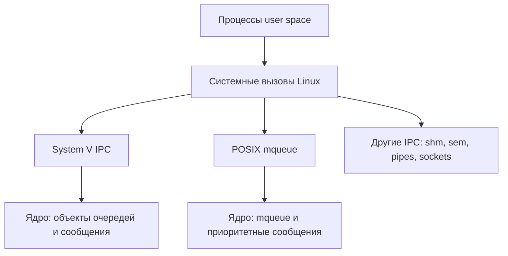
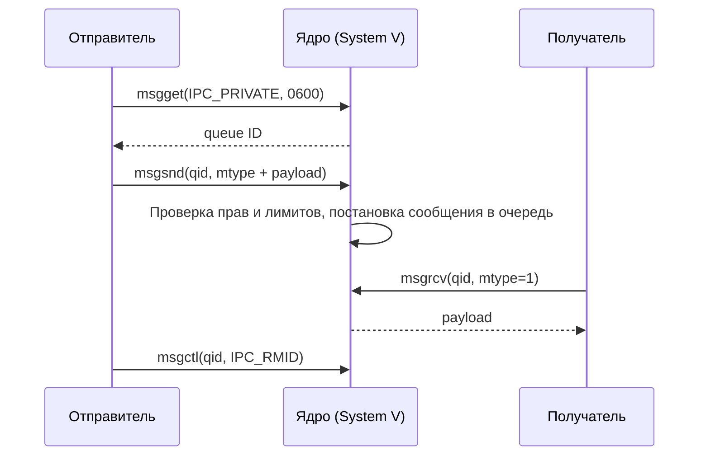

# Глава 1. Теория IPC и очередей сообщений Linux

## 1.1. Что такое IPC

Inter-process communication (IPC) — механизмы для передачи данных и координации отдельных процессов. В Linux применяются pipes, sockets, разделяемая память, семафоры и очереди сообщений. Очередь позволяет отправителю поместить дискретное сообщение в объект ядра, после чего получатель извлекает его; процессы не обязаны исполняться одновременно.

**Рисунок 1 — упрощённая архитектура межпроцессного взаимодействия.** Эту Mermaid-схему можно отобразить в GitHub Markdown; для отчёта экспортируйте в PNG/SVG.

## 1.2. System V IPC

Ключевой API: `msgget(key, flags)` — поиск/создание очереди, `msgsnd(qid, msgp, msgsz, flags)` — отправка, `msgrcv(qid, msgp, msgsz, msgtyp, flags)` — получение, `msgctl(qid, cmd, ...)` — чтение параметров, изменение настроек или удаление. Сообщение включает `long mtype`, за которым располагается payload. `msgsz` **не включает** поле `mtype`. Для создания учебных очередей подходит `IPC_PRIVATE` с правами `0600`, исключающий конфликт фиксированных ключей.

`IPC_NOWAIT` переводит вызов отправки в неблокирующий режим: при заполненной очереди `msgsnd()` завершается с `EAGAIN`. У System V есть фильтрация по `mtype`, но нет встроенной POSIX-модели приоритетов.

**Рисунок 2 — логический путь System V сообщения.** Точная реализация размещения в памяти зависит от версии ядра. Не следует выдавать схему за трассу конкретных kmalloc-вызовов без исходников того же ядра.

## 1.3. POSIX message queues

API: `mq_open()` создаёт/открывает именованную очередь (`/name`), `mq_send()` и `mq_receive()` передают сообщения, `mq_getattr()` читает атрибуты, `mq_close()` закрывает дескриптор, `mq_unlink()` удаляет имя. На Linux такие очереди могут отображаться в `/dev/mqueue` после монтирования `mqueue`. Приоритет сообщений задаётся отдельным целым числом. На Linux POSIX-дескрипторы можно опрашивать с помощью `poll`/`select`/`epoll` (специфика реализации Linux).

С точки зрения безопасности важна персистентность: объект может переживать завершение процесса до удаления/выключения системы. Обязательно вызывать `mq_unlink`, даже при ошибке последующих операций.

## 1.4. Сравнение

| Признак | System V | POSIX |
| --- | --- | --- |
| Создание | `msgget()` | `mq_open()` |
| Идентификация | `key_t`, queue ID | имя `/queue`, дескриптор `mqd_t` |
| Фильтрация | по типу `mtype` | приоритет сообщения |
| Чтение | `msgrcv()` | `mq_receive()` |
| Управление | `msgctl()` | `mq_getattr()`, `mq_setattr()` |
| Удаление | `msgctl(IPC_RMID)` | `mq_unlink()` |
| Лимиты | `kernel.msgmax/msgmnb/msgmni`, `msg_qbytes` | `fs.mqueue.*`, `mq_attr`, `RLIMIT_MSGQUEUE` |
| Наблюдение | `ipcs`, `/proc/sysvipc/msg` | `/dev/mqueue`, `mq_getattr()` |

## 1.5. Внутреннее устройство ядра

Для System V следует изучать `ipc/msg.c`, `ipc/msgutil.c`, `include/linux/msg.h`. Объекты `struct msg_queue` представляют очереди, `struct msg_msg` — заголовок/метаданные сообщения; длинные сообщения могут использовать `struct msg_msgseg`. В разных ядрах размещение, caches и реализация могут изменяться, поэтому текст главы ссылается на **актуальные исходники и фиксированный релиз**, а не обещает одну структуру для всех версий.

Для POSIX важен `ipc/mqueue.c`. В практической части достаточно наблюдать системные вызовы и лимиты; мы не будем получать адреса структур, манипулировать кэшем или составлять exploit chain.

## 1.6. Что подтвердить в Kali

- `strace` должен показать System V вызовы `msgget`, `msgsnd`, `msgrcv`, `msgctl`.
- POSIX программа демонстрирует `mq_open`, `mq_timedsend`, `mq_timedreceive`, `mq_unlink` (названия системных вызовов могут отличаться от имён библиотечных обёрток).
- Для отчёта использовать скриншоты 05–07 и схемы 1–2.

**Источники:** `docs/SOURCES.md`, ссылки раздела «Глава 1».
